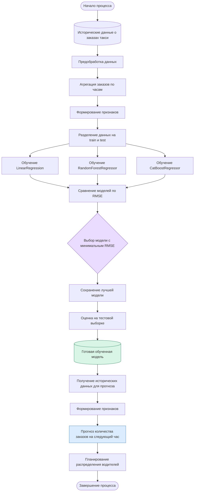

# Model BPMN — Место модели в бизнес-процессе прогнозирования заказов такси

## 1. Схема процесса

Диаграмма показывает место MLOps-пайплайна в процессе прогнозирования спроса на такси: от получения исторических данных до формирования прогноза, который может использоваться при планировании распределения водителей.

## 2. Описание бизнес-процесса

### Какую задачу в процессе решает модель?

Модель решает задачу прогнозирования количества заказов такси на следующий час. Это позволяет заранее оценивать ожидаемый спрос и учитывать его при планировании распределения водителей.

### Почему для этой задачи целесообразно использовать ML?

Количество заказов зависит от нескольких факторов: времени суток, дня недели и исторической динамики спроса. Машинное обучение позволяет находить закономерности в исторических данных и использовать их для прогнозирования будущего спроса.

В проекте сравниваются три алгоритма: LinearRegression, RandomForestRegressor и CatBoostRegressor. Автоматизированный пайплайн оценивает их качество по метрике RMSE и выбирает лучшую модель. В текущем эксперименте победила LinearRegression с RMSE = 34.

### Какие данные поступают на вход модели?

Для формирования прогноза используются следующие признаки:

- **Календарные признаки:** день недели и час суток.
- **Лаговые признаки:** количество заказов за предыдущие 1, 23, 24, 48, 72 и 168 часов.
- **Скользящее среднее:** среднее количество заказов за предыдущие 24 часа.

Исходными данными являются исторические сведения о количестве заказов такси, агрегированные по часам. Целевая переменная при обучении — `num_orders`.

### Как результат работы модели используется дальше в процессе?

Результатом работы модели является числовой прогноз количества заказов такси на следующий час.

Этот прогноз может передаваться в бизнес-процесс планирования распределения водителей. На его основе можно оценить ожидаемую потребность в машинах и скорректировать их распределение между временными интервалами.

Таким образом, модель связывает исторические данные о спросе с принятием операционных решений.

**Примечание:** в текущем проекте реализованы подготовка данных, обучение, сравнение и сохранение моделей, а также оценка их качества. Интеграция готовой модели с отдельным сервисом прогнозирования и системой распределения водителей рассматривается как возможное дальнейшее развитие проекта.
