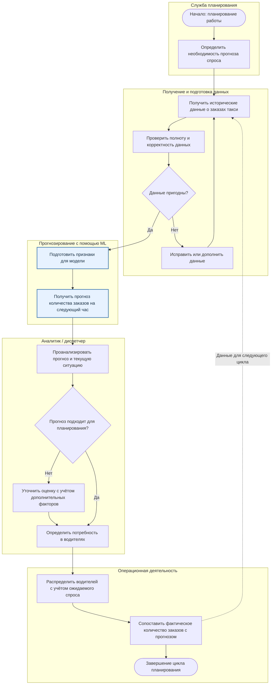
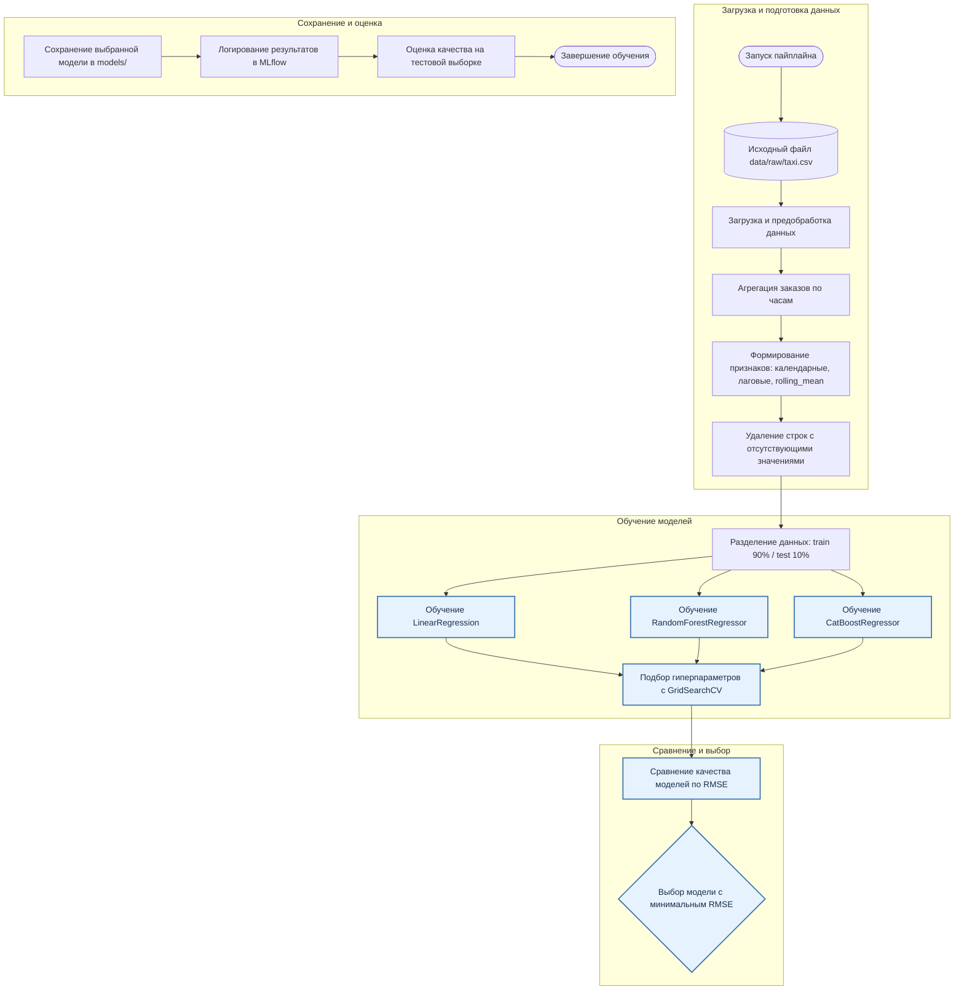

# Model BPMN — Роль модели в бизнес-процессе и MLOps-проекте

Проект: Taxi Orders Forecasting.

**Задача проекта:** прогнозирование количества заказов такси на следующий час с помощью автоматизированного MLOps-пайплайна, который обучает несколько моделей, сравнивает их качество и выбирает лучшую.

В документе представлены две взаимодополняющие схемы:

- Первая показывает бизнес-процесс: возможное использование прогноза для планирования распределения водителей. Это целевой сценарий применения модели, а не уже реализованный бизнес-сервис.
- Вторая показывает технический процесс: фактическую подготовку данных, обучение, сравнение и сохранение моделей в рамках проекта.

---

## 1. Бизнес-процесс: прогнозирование спроса для планирования распределения водителей

### 1.1. Бизнес-задача и участники

Сценарий: служба планирования такси должна заранее оценивать ожидаемое количество заказов в аэропортах, чтобы эффективнее распределять водителей в зависимости от предполагаемого спроса.

Если ориентироваться только на текущее количество заказов, сложно заранее учитывать изменение спроса в течение суток и недели. Прогнозирование позволяет получить оценку будущей нагрузки и использовать её при планировании.

В предполагаемом бизнес-процессе участвуют:

- **Служба планирования** — определяет потребность в прогнозе и использует его для планирования ресурсов.
- **Владелец данных** — обеспечивает предоставление исторической информации о заказах.
- **ML-система** — формирует прогноз на основе исторических данных.
- **Аналитик или диспетчер** — проверяет прогноз и учитывает его при принятии решений.
- **Операционные подразделения** — реализуют принятое решение по распределению водителей.

Модель предоставляет прогноз, но не принимает управленческие решения самостоятельно.

### 1.2. BPMN-схема бизнес-процесса

### 1.3. Описание этапов бизнес-процесса

| Этап | Что происходит | Результат |
|---|---|---|
| 1. Определение потребности | Служба планирования определяет необходимость оценки будущего спроса | Запрос на прогноз |
| 2. Получение данных | Собирается историческая информация о количестве заказов такси | Исторические данные |
| 3. Проверка данных | Проверяются полнота и корректность исходной информации | Подготовленные данные |
| 4. Прогнозирование | ML-модель обрабатывает признаки и рассчитывает ожидаемое количество заказов | Прогноз на следующий час |
| 5. Анализ прогноза | Аналитик или диспетчер оценивает прогноз с учётом текущей ситуации | Оценка ожидаемого спроса |
| 6. Планирование | Определяется необходимое количество водителей и их распределение | План распределения ресурсов |
| 7. Исполнение и контроль | Водители распределяются с учётом плана, фактические заказы сопоставляются с прогнозом | Информация для следующего цикла планирования |

### 1.4. Роль ML в бизнес-процессе

**Какую задачу в процессе решает модель?**

Модель прогнозирует количество заказов такси на следующий час. Полученная оценка позволяет заранее определить ожидаемую нагрузку и учитывать её при планировании распределения водителей.

**Почему для этой задачи целесообразно использовать ML?**

Количество заказов зависит от времени суток, дня недели и предыдущей динамики спроса. Машинное обучение позволяет выявлять закономерности в исторических данных и использовать их для прогнозирования будущих значений.

В проекте сравниваются три алгоритма: LinearRegression, RandomForestRegressor и CatBoostRegressor. Автоматизированный пайплайн позволяет оценить их качество по метрике RMSE и выбрать модель с наименьшей ошибкой.

В текущем эксперименте лучшей оказалась LinearRegression с RMSE = 34.

**Какие данные поступают на вход модели?**

Для формирования прогноза используются:

- исторические данные о количестве заказов, агрегированные по часам;
- календарные признаки: день недели и час суток;
- лаговые признаки: количество заказов за предыдущие 1, 23, 24, 48, 72 и 168 часов;
- скользящее среднее количества заказов за предыдущие 24 часа.

Целевая переменная при обучении — `num_orders`.

**Как результат работы модели используется дальше в процессе?**

Результатом работы модели является числовой прогноз количества заказов такси на следующий час.

В предполагаемом бизнес-сценарии прогноз передаётся службе планирования или диспетчеру. На его основе можно оценить ожидаемую потребность в машинах и скорректировать распределение водителей между временными интервалами.

Прогноз выступает дополнительным источником информации для принятия операционных решений, но не заменяет оценку текущей ситуации и другие факторы планирования.

---

## 2. Технический процесс: работа MLOps-пайплайна

### 2.1. Техническая схема

В отличие от предыдущей схемы, здесь отражена фактическая работа проекта: от загрузки исходного CSV-файла до выбора и сохранения лучшей модели.

### 2.2. Описание технического процесса

| Этап | Что происходит | Результат |
|---|---|---|
| 1. Загрузка данных | Из файла `data/raw/taxi.csv` загружается историческая информация о заказах | Исходный набор данных |
| 2. Предобработка | Данные приводятся к временному формату и агрегируются с интервалом в один час | Почасовой временной ряд |
| 3. Формирование признаков | Создаются календарные признаки, лаги и скользящее среднее | Набор признаков для обучения |
| 4. Разделение данных | Данные разделяются на обучающую и тестовую выборки без перемешивания | Train и test |
| 5. Обучение моделей | Обучаются LinearRegression, RandomForestRegressor и CatBoostRegressor | Три обученные модели |
| 6. Подбор параметров | Используется GridSearchCV для поиска подходящих гиперпараметров | Настроенные модели |
| 7. Сравнение моделей | Качество алгоритмов сопоставляется по RMSE | Результаты сравнения |
| 8. Выбор модели | Выбирается алгоритм с наименьшим значением RMSE | Лучшая модель |
| 9. Сохранение и логирование | Модель сохраняется в `models/`, результаты экспериментов регистрируются в MLflow | Сохранённая модель и информация об эксперименте |
| 10. Оценка | Выполняется оценка качества на тестовой выборке | Итоговая оценка модели |

### 2.3. Результаты сравнения моделей

В текущем эксперименте были получены следующие значения RMSE:

| Модель | RMSE |
|---|---:|
| LinearRegression | **34** |
| CatBoostRegressor | 40 |
| RandomForestRegressor | 42 |

Меньшее значение RMSE означает меньшую ошибку прогнозирования.

По результатам сравнения пайплайн выбрал LinearRegression. Она показала наименьшую ошибку среди трёх рассмотренных алгоритмов.

Это демонстрирует важность автоматизированного сравнения: более сложная модель не обязательно оказывается точнее простой линейной регрессии на конкретном наборе данных.

### 2.4. Результат работы технического процесса

Результатом работы MLOps-пайплайна является обученная и сохранённая модель, выбранная на основании сравнения нескольких алгоритмов.

Проект автоматизирует подготовку данных, обучение, подбор параметров, сравнение качества и сохранение результатов экспериментов. Для логирования используется MLflow, а сохранённые модели размещаются в директории `models/`.

При этом текущая реализация не включает отдельный сервис, который автоматически получает новые данные каждый час, формирует прогноз и передаёт его в систему распределения водителей. Такая интеграция может стать следующим этапом развития проекта.

---

## 3. Разделение реализованного и предполагаемого функционала

Для корректного описания проекта важно различать фактически реализованные компоненты и возможный сценарий их дальнейшего применения.

| Компонент | Статус |
|---|---|
| Загрузка и предобработка исторических данных | Реализовано |
| Агрегация данных по часам | Реализовано |
| Формирование календарных и лаговых признаков | Реализовано |
| Обучение трёх алгоритмов | Реализовано |
| Подбор гиперпараметров | Реализовано |
| Сравнение моделей по RMSE | Реализовано |
| Выбор лучшей модели | Реализовано |
| Логирование экспериментов в MLflow | Реализовано |
| Сохранение обученной модели | Реализовано |
| Использование прогноза для планирования водителей | Предполагаемый бизнес-сценарий |
| Автоматическая интеграция с диспетчерской системой | Не реализовано |

Таким образом, техническая часть проекта представляет собой автоматизированный MLOps-пайплайн обучения и выбора модели, а бизнес-схема показывает, каким образом результат его работы может применяться для решения практической задачи прогнозирования спроса на такси.
