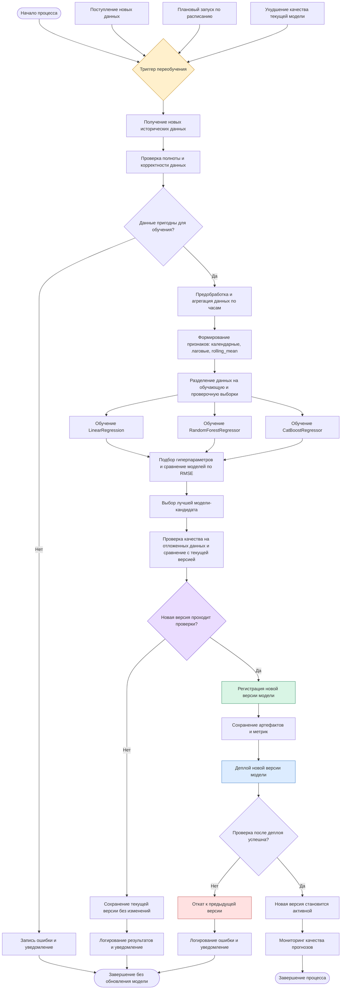

# Model Retrain BPMN — Процесс автоматического переобучения модели

## 1. Описание процесса

Цель процесса — обеспечить регулярное обновление модели прогнозирования количества заказов такси на следующий час. При поступлении новых исторических данных запускается процесс переобучения, в рамках которого обучаются новые версии моделей, оценивается их качество и принимается решение о публикации.

В качестве основы используется существующий MLOps-пайплайн проекта Taxi Orders Forecasting, который обучает три алгоритма: LinearRegression, RandomForestRegressor и CatBoostRegressor, сравнивает их по RMSE и выбирает лучшую модель.

Процесс переобучения предусматривает следующие этапы:

1. Возникновение триггера переобучения.
2. Получение и подготовка новых данных.
3. Обучение новых версий моделей.
4. Проверка качества и сравнение с текущей версией.
5. Принятие решения о публикации.
6. Регистрация и сохранение новой версии модели.
7. Развёртывание новой версии.
8. Контроль работы и возможность возврата к предыдущей версии.

## 2. Схема процесса автоматического переобучения

## 3. Описание основных этапов

### 3.1. Триггер запуска переобучения

Процесс переобучения может запускаться по нескольким причинам:

- **Поступление новых данных.** В наборе данных накопилось достаточно новых наблюдений, чтобы обновить модель.
- **Плановый запуск.** Переобучение выполняется через определённые промежутки времени, например раз в неделю.
- **Ухудшение качества модели.** При мониторинге обнаружено увеличение ошибки прогнозирования, что может свидетельствовать об изменении характера спроса.

**Результат:** событие, инициирующее запуск процесса переобучения.

### 3.2. Получение и подготовка новых данных

После возникновения триггера система получает обновлённые исторические данные о количестве заказов такси.

Далее выполняются:
- проверка полноты и корректности данных;
- преобразование временных меток;
- агрегация количества заказов по часам;
- формирование календарных признаков;
- создание лаговых признаков;
- расчёт скользящего среднего за предыдущие 24 часа;
- удаление строк с отсутствующими значениями.

Подготовка выполняется с использованием логики, уже реализованной в проекте.

**Результат:** подготовленный набор данных с признаками, пригодный для обучения моделей.

### 3.3. Обучение новой версии модели

На подготовленных данных запускается обучение трёх алгоритмов:

- LinearRegression;
- RandomForestRegressor;
- CatBoostRegressor.

Для подбора гиперпараметров используется GridSearchCV.

После обучения модели сравниваются по RMSE. В качестве кандидата на публикацию выбирается модель с наименьшей ошибкой на проверочной выборке.

**Результат:** обученная модель-кандидат и результаты сравнения алгоритмов.

### 3.4. Проверка качества новой модели

Качество новой версии проверяется на данных, которые не использовались при обучении и подборе гиперпараметров.

Дополнительно результат сравнивается с качеством текущей опубликованной версии модели.

Основной критерий оценки — RMSE. Новая модель должна показывать качество не хуже установленного порога и удовлетворять дополнительным проверкам.

Например, можно предусмотреть следующие условия:
- RMSE новой версии не превышает допустимый порог;
- RMSE новой версии не хуже RMSE текущей модели;
- модель успешно загружается и выполняет прогнозирование;
- структура входных признаков соответствует ожидаемой.

**Результат:** результаты проверки качества и решение о возможности публикации.

### 3.5. Принятие решения о публикации

После проверки качества принимается решение:

- **Проверки пройдены.** Новая версия допускается к публикации.
- **Проверки не пройдены.** Новая версия отклоняется, а текущая модель продолжает использоваться.

При отклонении кандидата результаты эксперимента сохраняются, а ответственным отправляется уведомление.

**Результат:** подтверждение публикации новой версии либо отказ от обновления.

### 3.6. Регистрация и сохранение новой версии модели

Если новая модель прошла проверки, она регистрируется как новая версия.

Сохраняются:
- обученная модель;
- версия модели;
- параметры обучения;
- метрики качества;
- информация об использованных данных и эксперименте.

Для отслеживания экспериментов и хранения артефактов может использоваться MLflow.

**Результат:** зарегистрированная и сохранённая версия модели, готовая к развёртыванию.

### 3.7. Деплой новой версии модели

После регистрации новая версия развёртывается в среде, где выполняется прогнозирование.

Перед переключением на новую версию проверяется:
- возможность загрузки модели;
- корректность входных данных;
- успешное выполнение прогнозирования;
- отсутствие критических ошибок.

Если проверки успешны, новая версия становится активной.

**Результат:** новая версия модели доступна для формирования прогнозов.

### 3.8. Действия при неуспешном прохождении проверок

Если новая версия не проходит проверку качества, она не публикуется, а система продолжает использовать предыдущую версию.

Если ошибка возникает уже после деплоя, выполняется откат к предыдущей стабильной версии.

Информация об ошибке и результатах проверки сохраняется в журнале экспериментов, ответственным отправляется уведомление.

**Результат:** сохранение работоспособности системы прогнозирования без использования некачественной версии модели.

## 4. Результат процесса

Результатом успешного выполнения процесса является новая версия модели прогнозирования количества заказов такси, прошедшая проверку качества и развёрнутая вместо предыдущей версии.

Если новая модель не проходит проверки, текущая версия остаётся активной. Таким образом, механизм переобучения позволяет регулярно обновлять модель с учётом новых данных, контролировать качество прогнозирования и снижать риск публикации неудачных обновлений.

## 5. Связь с текущей реализацией проекта

В текущем проекте уже реализованы основные компоненты, необходимые для обучения и выбора новой модели:

| Компонент | Статус |
|---|---|
| Загрузка исторических данных | Реализовано |
| Предобработка и агрегация по часам | Реализовано |
| Формирование признаков | Реализовано |
| Обучение трёх алгоритмов | Реализовано |
| Подбор гиперпараметров | Реализовано |
| Сравнение моделей по RMSE | Реализовано |
| Выбор лучшей модели | Реализовано |
| Логирование экспериментов в MLflow | Реализовано |
| Сохранение обученной модели | Реализовано |
| Автоматический запуск переобучения по триггеру | Требует реализации |
| Мониторинг качества действующей модели | Требует реализации |
| Сравнение новой версии с опубликованной | Требует реализации |
| Регистрация версий в Model Registry | Требует настройки |
| Автоматический деплой новой версии | Требует реализации |
| Автоматический откат к предыдущей версии | Требует реализации |

Представленная схема описывает целевую архитектуру автоматического переобучения, построенную на основе существующего MLOps-пайплайна. Она показывает, как текущую систему обучения можно расширить до полного цикла управления версиями модели — от появления новых данных до публикации и контроля обновлённой модели.
